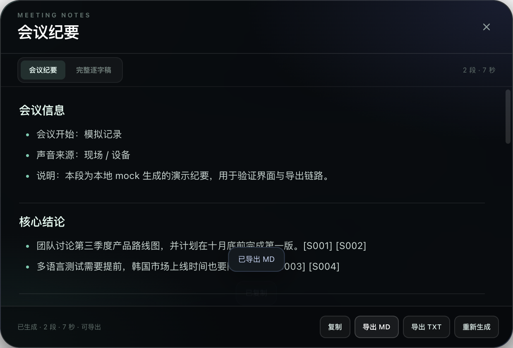

# 浮译 FloatLingo

[](LICENSE)
[](https://github.com/iris-pc/floatlingo/releases/latest)
[](#1-能力与限制先看这里)
[](https://github.com/iris-pc/floatlingo)

> 一个 macOS 实时翻译浮窗：同时听「现场人声」和「电脑里播放的人声」，把原文实时识别出来，并流式翻译成韩语。

- **双路收音**：麦克风（现场）与系统音频（会议 / 视频 / 电话另一端）分别识别，单独标注「现场 / 设备」，不会把两边混成一团。
- **低延迟**：OpenAI `gpt-live-transcribe` 流式转写 + VAD 断句，原文通常 1–2 秒出现；界面显示实测的「原文延迟」与「翻译首字延迟」。
- **韩语流式字幕**：`DeepSeek` 或 `OpenAI` 翻译，边说边出字幕；一句话没说完也会先给草稿，停顿后校正为最终译文。
- **真正的浮窗**：无边框、圆角、半透明、始终置顶、可缩放、可点击穿透；`⌘⇧T` 显示/隐藏。
- **事后会议纪要**：停止后直接生成中文会议纪要，保留数字、决议、待办和关键原话，并自动附上未经改写的完整逐字稿；`⌘⇧M` 打开。
- **隐私优先**：不保存音频；API Key 优先用 macOS 钥匙串加密保存；全部处理只发生在内存和所选 API 之间。


---

## 1. 能力与限制（先看这里）

### 已实现

| 能力 | 实现 |
| --- | --- |
| 现场人声 | `getUserMedia` + AudioWorklet，24 kHz 单声道 PCM |
| 喇叭/系统人声 | 原生 ScreenCaptureKit 辅助程序，捕获系统音频，不采集画面 |
| 回声/重复识别 | 麦克风开启 `echoCancellation`，系统音频单独成路；界面可分别开关 |
| 实时原文 | OpenAI Realtime transcription WebSocket（`gpt-live-transcribe`） |
| 标准兼容模式 | HTTP 分段上传 `gpt-4o-transcribe` / `whisper-1`，适合账号不支持实时模型时 |
| 韩语翻译 | DeepSeek `deepseek-chat` 或 OpenAI `gpt-4o-mini`，SSE 流式输出 |
| 术语表 / 提示词 | 支持专有名词、人名、产品名和翻译术语表 |
| 记录 | 会话内双语记录，导出 `.txt` |
| 会议纪要 | 停止会话后生成中文纪要 + 完整逐字稿附录，支持 Markdown/TXT 导出；长会议分段处理，不截断 |
| 演示模式 | 不需要 API Key，直接看界面与字幕效果 |

### 重要限制

1. **语音识别必须用 OpenAI（或兼容 OpenAI 的转写服务）。**
   DeepSeek 目前没有公开的语音转文字 API；DeepSeek 在这个项目里负责**翻译**。这是 API 能力边界，不是代码取舍。
2. **系统音频捕获目前只支持 macOS 13+。**
   Windows 的 Chromium loopback 分支已预留，但当前版本没有完整实现 Windows 系统音频采集。
3. **macOS 的“屏幕与系统音频录制”权限需要手动授权一次。**
   ScreenCaptureKit 属于隐私敏感能力；系统不会允许应用静默获取。授权步骤见第 4 节。
4. **“3 秒”是目标，不是硬保证。**
   延迟取决于网络、API 队列、说话停顿、模型版本和机器负载。应用会把真实测量值显示在卡片右上角和底栏，方便调参。
5. **没有声纹分离。**
   「现场」里的多个说话人不会自动区分张三/李四；「设备」里的多个远端说话人也不会。双路只区分“现场 vs 设备”。

---

## 下载安装

- **GitHub Release**：[FloatLingo v1.0.0](https://github.com/iris-pc/floatlingo/releases/tag/v1.0.0)
- 直接下载：[FloatLingo-1.0.0-arm64.dmg](https://github.com/iris-pc/floatlingo/releases/download/v1.0.0/FloatLingo-1.0.0-arm64.dmg)（114 MB，Apple Silicon）
- 校验和：[SHA256SUMS.txt](https://github.com/iris-pc/floatlingo/releases/download/v1.0.0/SHA256SUMS.txt)
- 发布说明：[v1.0.0 Release Notes](docs/RELEASE_NOTES_v1.0.0.md)

这是 **ad-hoc 本地签名**，第一次打开若被 Gatekeeper 拦截，请右键 → 打开。公开发布请参考第 6 节做 Developer ID 签名和公证。

### 从源码运行

```bash
git clone https://github.com/iris-pc/floatlingo.git
cd floatlingo
npm install
npm run build:helper
npm start
```

完整环境要求、API Key、系统音频权限见下文。

## 2. 快速开始（源码运行）

### 环境

- macOS 13 或更高（系统音频依赖 ScreenCaptureKit）
- Node.js 22.12+
- Xcode Command Line Tools（编译 Swift 辅助程序）
- 可访问 OpenAI API；翻译可选 DeepSeek

### 安装

```bash
npm install

# 编译系统音频辅助程序（会产出 dist/SystemAudioCapture.app）
npm run build:helper

# 启动
npm start
```

如果终端环境里设置了 `ELECTRON_RUN_AS_NODE=1`（某些 IDE/Agent 环境会这样），Electron 会被当成 Node 启动，表现为 `app is undefined`。用下面的方式启动：

```bash
env -u ELECTRON_RUN_AS_NODE npm start
```

### 填写 Key

首次启动会自动打开设置：

1. **OpenAI API Key**：必填，用于语音识别；如果翻译也选 OpenAI，则同一个 Key 同时用于翻译。
2. **DeepSeek API Key**：翻译选 DeepSeek 时必填。
3. 点「保存设置」。

Key 也可以走环境变量（适合开发）：

```bash
export OPENAI_API_KEY="sk-..."
export DEEPSEEK_API_KEY="sk-..."
npm start
```

环境变量的优先级低于应用内保存的 Key。

### 开始

1. 打开「现场人声」和/或「设备声音」。
2. 点「开始实时翻译」。
3. 首次使用麦克风时允许麦克风权限。
4. 系统音频若提示未授权，按第 4 节授权后重新开始会话。

---

## 3. 3 秒延迟是怎么做到的

```
麦克风 ──┐
         ├─ AudioWorklet 24kHz PCM ─┐
系统音频 ─┘                          ├─ VAD 断句 ─ OpenAI Realtime 转写（delta）─┐
                                     │                                             ├─ 原文上屏
                                     └─ 音频持续 append 到 WebSocket                 │
                                                                                   ↓
                                                               DeepSeek / OpenAI 翻译（SSE）
                                                                                   ↓
                                                                              韩语流式字幕
```

关键点：

- **音频不攒到最后才发**：每 100 ms 的 PCM 立即 append 到 Realtime WebSocket；转写模型边说边返回 `delta`。
- **VAD 只负责断句/commit，不负责“开始识别”**：因此一句话还没说完时，原文已经在增长。
- **草稿翻译 + 最终翻译**：
  - 说话过程中，最多每 1.4 秒对当前原文发一次轻量翻译请求，韩语字幕持续跟随；
  - 检测到 600 ms 停顿（可调）或达到最长片段（默认 12 秒）时 commit，收到最终原文后立刻用最终译文替换草稿。
- **双路独立**：现场和系统音频各有自己的 VAD、WebSocket、翻译队列；重叠说话不会互相覆盖。

### 调参建议

| 目标 | 调整 |
| --- | --- |
| 原文更快 | 识别延迟选 `minimal` 或 `low`；降低「停顿断句」到 400–500 ms |
| 翻译更快 | 降低「实时草稿翻译间隔」（高级设置/代码中的 `partialTranslateMs`）；用 DeepSeek 通常首 token 更快 |
| 更准确 | 识别延迟选 `medium`/`high`；明确「说话语言」而不是自动；填写术语提示 |
| 减少 API 费用 | 只开一路声音；关闭不需要的草稿翻译；标准模式按句上传 |
| 减少重复 | 戴耳机；降低麦克风增益；确认系统音频与麦克风不是同一路回环 |

> 注意：Realtime 转写按音频时长计费，双路 = 双倍音频时长；草稿翻译按请求计费。长时间会议建议先用演示模式确认交互，再用真实 Key 小规模测试。

---

## 3.1 事后生成会议纪要（保留实际内容）



停止识别后，底栏会出现「纪要」按钮（也可按 `⌘⇧M`，或在设置 → 记录里打开）。生成内容分为两个可切换的页签：

1. **会议纪要**：由 DeepSeek / OpenAI 根据逐字记录整理，中文输出，包含会议信息、核心结论、议题与讨论、决议、待办、风险/分歧/待确认、关键原话。
2. **完整逐字稿**：应用实际保存的逐段原文与当时韩译，**不经过模型改写**，用于核对纪要中的事实。

### 为什么说“以保留实际内容为准”

- 生成提示词明确要求：只能使用逐字记录中的事实，不得推测、补全、美化或引入外部知识。
- 每个要点尽量标注 `[S001]` 这样的来源编号，正文中的说法可以在逐字稿里逐条定位。
- 没有提到的负责人、日期、金额或决议，会写“未提及”，不会自动补一个。
- 原话引用必须逐字照抄，转写不清时标注「原文不清」。
- **导出文件会自动附加完整逐字记录附录**。即使模型摘要漏掉了某个细节，实际内容仍在附录里，可人工核对。
- 长会议不会被截断：超过约 2.4 万字符时，按时间顺序分段整理，每段都独立读取对应原文，最后合并；所有段仍全部进入附录。

### 使用流程

1. 停止识别。
2. 点底栏「纪要」。
3. 等待生成（长会议会显示第 N/M 段进度）。
4. 在「会议纪要 / 完整逐字稿」之间切换核对。
5. 复制，或导出 `.md` / `.txt`。

纪要使用当前选择的翻译引擎和对应 API Key：DeepSeek 纪要使用 DeepSeek Key，OpenAI 纪要使用 OpenAI Key。生成会计入相应 API 费用。

> 当前版本的历史记录保存在运行中的进程内；停止后可以直接生成纪要，但退出应用后不会自动持久化。需要长期归档时，请先生成并导出。

## 4. macOS 系统音频权限（关键）

系统音频不是普通麦克风权限，它属于 **Screen & System Audio Recording**（旧系统叫“屏幕录制”）。

### 步骤

1. 在浮译里点「开始实时翻译」；如果系统音频启动失败，点错误提示里的「去授权」。
2. 打开：

   **系统设置 → 隐私与安全性 → 屏幕与系统音频录制**

3. 找到 **FloatLingo Audio**（系统音频辅助程序）并打开开关。
   - 如果列表里没有，点左下角 `+`，选择：

     ```
     /Applications/FloatLingo.app/Contents/Resources/SystemAudioCapture.app
     ```

     源码运行时选择：

     ```
     <项目目录>/dist/SystemAudioCapture.app
     ```

4. 系统可能要求退出并重新打开应用；直接**停止会话再重新开始**即可。
5. 回到浮译，重新开始会话。

### 如果仍然提示“用户拒绝 TCC”

- 确认打开的是 **FloatLingo Audio**，不是只给 `FloatLingo` 主程序授权（两者是独立进程）。
- 在“屏幕与系统音频录制”列表里先关闭再打开开关。
- 退出浮译（菜单栏图标 → 退出），重新打开，再开始。
- 如果使用源码运行，路径变化后 macOS 可能把它当成新应用，需要重新授权。

> 辅助程序只调用 ScreenCaptureKit 的音频输出，不请求视频帧、不写屏幕画面到磁盘、不上传画面。

---

## 5. API 配置

### 默认

| 项目 | 默认值 |
| --- | --- |
| 语音识别 | OpenAI Realtime，`gpt-live-transcribe`，`delay=low` |
| 识别语言 | 中文 + 英文（`zh`, `en`） |
| 翻译 | DeepSeek `deepseek-chat` |
| 目标语言 | 韩语（`ko`） |
| OpenAI Base URL | `https://api.openai.com/v1` |
| DeepSeek Base URL | `https://api.deepseek.com` |

### 如果账号没有 `gpt-live-transcribe`

打开「设置 → 识别 → 高级识别设置」：

- 把「识别模式」改成 **标准分段（兼容性）**；
- 模型改成 `gpt-4o-transcribe` 或 `whisper-1`。

标准模式会在 VAD 断句后上传 WAV，延迟比实时模式高，但兼容性最好。

### 自定义网关

`OpenAI Base URL` 和 `DeepSeek Base URL` 可以指向兼容网关。实时识别的 WebSocket 地址会从 Base URL 自动推导：

```
https://your-gateway/v1  ->  wss://your-gateway/v1/realtime?intent=transcription
```

网关需要支持 OpenAI Realtime transcription 的 `intent=transcription` 和 `gpt-live-transcribe` 事件协议；否则请使用标准分段模式。

### 术语表示例

在「设置 → 翻译 → 术语表」中：

```
DeepSeek = 딥시크
产品路线图 = 제품 로드맵
Q3 = 3분기
```

在「术语 / 人名提示」中每行一个词，帮助转写模型正确识别专有名词。

---

## 6. 打包 macOS App

```bash
npm run dist
open release/mac-arm64/FloatLingo.app
```

产物：

```
release/mac-arm64/FloatLingo.app
```

`npm run dist` 会：

1. 编译 `dist/SystemAudioCapture.app`；
2. 用 electron-builder 打包 `.app`；
3. 对主应用和辅助程序做 **ad-hoc 签名**（本地运行足够，但不适合公开分发）。

### 正式分发

公开分发需要：

- Apple Developer ID Application 证书；
- 对主应用和 `SystemAudioCapture.app` 一起签名；
- notarization（公证）。

```bash
CODESIGN_IDENTITY="Developer ID Application: Your Name (TEAMID)" npm run dist
```

然后使用 `notarytool` 提交公证。`scripts/sign-app.sh` 已支持通过 `CODESIGN_IDENTITY` 指定证书。

### 生成 DMG

```bash
npm run dist:dmg
```

如果 `--prepackaged` 在你的 electron-builder 版本上不可用，直接执行：

```bash
npm run dist
npx electron-builder --mac dmg --prepackaged release/mac-arm64/FloatLingo.app
```

---

## 7. 开发与测试

### 单元测试

```bash
npm run test:unit
```

覆盖 VAD、WAV 封装、Realtime URL 推导、翻译提示词。

### 本地 mock（不花 API 费用）

```bash
# 终端 A
npm run mock

# 终端 B：把测试配置复制到临时 profile 并按需修改 Base URL
mkdir -p /tmp/floatlingo-test
cp test/e2e-profile/settings.json /tmp/floatlingo-test/settings.json

OPENAI_API_KEY=test DEEPSEEK_API_KEY=test \
  env -u ELECTRON_RUN_AS_NODE \
  npx electron . --simulate-audio \
  --user-data-dir=/tmp/floatlingo-test
```

`--simulate-audio` 会向管线注入合成语音包络，完整跑通 VAD → Realtime 协议 → 翻译 SSE → UI，但不需要真实麦克风。

### Playwright 端到端

```bash
npm run mock
node test/e2e-ui.js          # 实时模式
node test/e2e-http.js        # 标准分段模式
node test/e2e-settings.js    # 设置面板截图
```

### 目录

```
electron/
  main.js                  Electron 主进程 / 窗口 / IPC / 托盘
  preload.js               安全桥
  pipeline.js              双路 VAD → STT → 翻译 → 字幕数据模型
  settings.js              设置与钥匙串 Key
  translate.js             DeepSeek / OpenAI 流式翻译
  minutes.js               会议纪要生成、长会议分段、逐字稿附录
  stt/realtime.js          OpenAI Realtime transcription WebSocket
  stt/http.js              HTTP 分段转写
  audio/vad.js             能量 VAD
  audio/system-audio.js    Swift 辅助进程管理
  audio/wav.js             WAV 封装
native/SystemAudioCapture/ Swift ScreenCaptureKit 系统音频捕获
src/                       浮窗 UI / AudioWorklet
scripts/                   mock API、签名
test/                      单元与 E2E 测试
```

---

## 8. 常见问题

### 只有「现场」有字幕，「设备」没有

系统音频权限未开。按第 4 节授权 **FloatLingo Audio**，然后停止并重新开始会话。

### 系统音频有字幕，但现场人声重复出现

麦克风把扬声器声音也收了进来。应用已开启回声消除，但外放音量过大时仍可能残留。戴耳机、降低音量或关闭「现场人声」一路。

### 原文出现了，但没有韩语

- 检查当前翻译引擎对应的 Key 是否填写；
- 点卡片上的「重试」；
- 检查 API 余额/网络；
- 如果错误是 401，重新保存 Key；
- 如果 API 网关不支持流式，确认返回 `text/event-stream`。

### 延迟超过 3 秒

- 识别延迟改为 `low` 或 `minimal`；
- 减少「停顿断句」；
- 检查网络到 OpenAI 的 RTT；
- 双路同时开启会增加并发和费用，先只开一路测试；
- 标准分段模式天然更慢，切回实时模式（如果账号支持）。

### 会议纪要生成失败

- 确认当前翻译引擎对应的 Key 已填写（DeepSeek 或 OpenAI）；
- 检查 API 余额、网络和模型名；
- 长会议会分成多次请求，网络中断时可能在中途失败；逐字稿仍然保留，可重试；
- 生成失败不影响已识别内容，可切到「完整逐字稿」复制或导出。

### `gpt-live-transcribe` 报 model not found / 400

账号或网关不支持该模型。改用「标准分段」+ `gpt-4o-transcribe` / `whisper-1`。

### 应用启动后立刻退出，日志里有 `app is undefined`

当前终端设置了 `ELECTRON_RUN_AS_NODE=1`。运行：

```bash
env -u ELECTRON_RUN_AS_NODE npm start
```

日志位置：

```
~/Library/Application Support/FloatLingo/logs/floatlingo.log
```

设置面板里有「打开日志」。

### macOS 提示“无法验证开发者”

这是 ad-hoc 签名的本地构建。右键应用 → 打开，或：

```bash
xattr -dr com.apple.quarantine /Applications/FloatLingo.app
```

公开分发请做 Developer ID 签名和公证。

---

## 9. 隐私与安全

- 音频只存在于内存和实时网络请求中，不写入磁盘。
- 默认不记录原始音频；导出的 `.txt` 仅包含识别文本和韩语译文，由你主动触发。
- API Key 优先使用 macOS `safeStorage`（钥匙串）加密；不可用时退化为本机 base64 存储，设置页会显示状态。
- 系统音频捕获不保存画面。
- 生成会议纪要时，逐字记录会发送给所选的 DeepSeek / OpenAI API；应用不会把纪要额外上传到别处。
- 请遵守会议参与方的知情同意和当地录音/隐私法律。
- 安全问题请按 [SECURITY.md](SECURITY.md) 私下报告，不要在公开 issue 中贴 API Key。

---

## 10. 下一步可以加什么

- Windows 系统音频（WASAPI loopback）
- 声纹分离 / 说话人标签
- 本地 Whisper / SenseVoice 离线识别
- 翻译结果 TTS 朗读
- 字幕历史持久化与搜索
- 多目标语言切换
- 低延迟音频重采样与 AEC 调优

---

MIT License. 仅用于学习与自用；API 费用、合规与会议授权由使用者自行负责。
